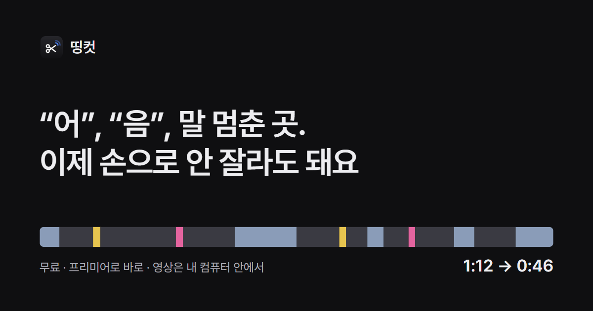

# 띵컷 (DDingCut)

촬영본에서 **말이 멈춘 곳 · "어"·"음" · 같은 말 반복**을 찾아 잘라 내고 자막을 만들어요.
결과는 프리미어 프로로 그대로 가져가요. 무료예요.

**→ [소개 페이지에서 받기](https://myoungji-kim.github.io/ddingcut/)**



## 받기

[Releases](https://github.com/myoungji-kim/ddingcut/releases/latest) 의 맨 위 판에서 받아요.

| 컴퓨터 | 파일 |
| --- | --- |
| Windows 10 · 11 | `DDingCut-Setup.exe` |
| Mac (M1 이후) | `DDingCut-mac-arm64.dmg` |
| Mac (Intel) | `DDingCut-mac-x64.dmg` |

아직 서명하지 않은 프로그램이라 **처음 한 번은 막혀요.**

- **Windows** — "Windows의 PC 보호" 창에서 [추가 정보] → [실행]
- **Mac** — dmg 를 열어 띵컷을 응용 프로그램 폴더로 끌어다 놓고 켜요. 막히면 [완료] →
  **시스템 설정 → 개인정보 보호 및 보안** 맨 아래의 [그래도 열기]. "손상되었기 때문에 열 수 없습니다" 가 뜨면
  터미널에서 한 번:
  ```bash
  xattr -dr com.apple.quarantine /Applications/DDingCut.app
  ```

처음 켜면 자막 만드는 도구를 뒤에서 받아요(약 2GB, NVIDIA 그래픽카드가 있으면 1.3GB 더). 그동안에도 컷 편집은 돼요.
영상과 소리는 이 컴퓨터 밖으로 나가지 않아요.

## 문제 알리기

[여기](https://github.com/myoungji-kim/ddingcut/issues/new?template=bug.yml)에 적어 주세요. 제안 · 질문은
[빈 이슈](https://github.com/myoungji-kim/ddingcut/issues/new)로 받아요.

## 이 저장소

설치 파일 · 소개 페이지 · 문제 신고만 둬요. 프로그램의 소스는 공개하지 않아요.

자막은 OpenAI 의 Whisper large-v3-turbo 모델을 [faster-whisper](https://github.com/SYSTRAN/faster-whisper) 로
돌려 만들어요(둘 다 MIT). 글꼴은 [Pretendard](https://github.com/orioncactus/pretendard)(SIL OFL 1.1, `fonts/OFL.txt`).
Premiere Pro 는 Adobe 의 상표이고, 띵컷은 Adobe 와 관계없는 개인 프로젝트예요.
