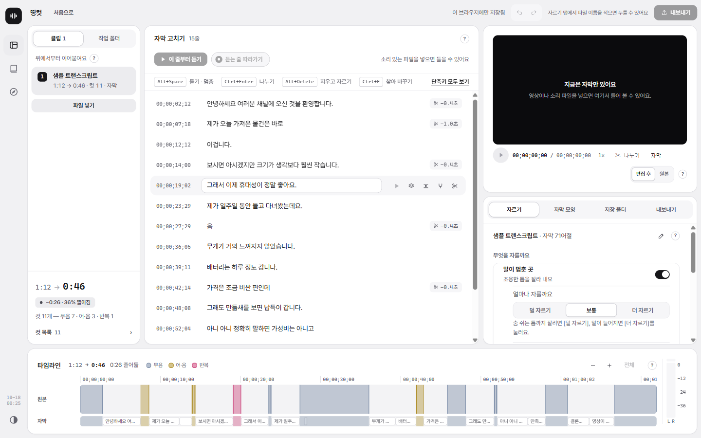

<h1 align="center">띵컷 · DDingCut</h1>

<p align="center">
  촬영본에서 <b>말이 멈춘 곳 · "어"·"음" · 같은 말 반복</b>을 찾아 잘라 내고, 자막까지 만들어요.<br>
  프리미어 프로로 그대로 가져가거나, 영상 파일(MP4)로 바로 저장해요. 무료예요.
</p>

<p align="center">
  <a href="https://myoungji-kim.github.io/ddingcut/#get"><b>Windows 받기</b></a>
  &nbsp;·&nbsp;
  <a href="https://github.com/myoungji-kim/ddingcut/releases/latest"><b>Mac 받기</b></a>
  &nbsp;·&nbsp;
  <a href="https://myoungji-kim.github.io/ddingcut/">소개 페이지</a>
</p>

<p align="center">
  <picture>
    <source media="(prefers-color-scheme: dark)" srcset="img/app-dark.png">
    
  </picture>
</p>

## 하는 일

- **자동으로 찾아요** — 조용한 틈, "어"·"음", 되풀이한 말을 찾아 컷으로 표시해요. 컷마다 들어 보고 켜거나 꺼요.
- **자막을 만들고 고쳐요** — 말을 글로 옮기고, 줄마다 보며 고쳐요. 자막 파일(SRT · VTT)을 넣어도 돼요.
- **결과를 가져가요** — 프리미어 시퀀스와 자막으로 넘기거나, 컷 · 자막 · 효과음을 입힌 MP4 한 편으로 저장해요.

영상과 소리는 **이 컴퓨터 밖으로 나가지 않아요.** 자막도 이 컴퓨터에서 만들어요. 가입도 없어요.

## 받기

| 컴퓨터 | 파일 |
| --- | --- |
| Windows 10 · 11 (64비트) | `DDingCut-Setup-<판>.exe` |
| Mac (M1 이후) | `DDingCut-mac-arm64-<판>.dmg` |
| Mac (Intel) | `DDingCut-mac-x64-<판>.dmg` |

[소개 페이지](https://myoungji-kim.github.io/ddingcut/#get)의 받기 단추가 알맞은 파일을 골라 줘요. 직접 고르려면 [Releases](https://github.com/myoungji-kim/ddingcut/releases/latest) 맨 위 판에서 받아요. 파일 이름의 `<판>`은 판 번호(예: 0.3.6)예요. 빈 공간 5GB가 필요하고, macOS 12 이상이에요.

## 처음 켤 때

아직 서명하지 않은 프로그램이라 **처음 한 번은 경고가 떠요.** 고장이 아니에요.

- **Windows** — "PC 보호" 창에서 본문 아래의 작은 **[추가 정보]** → **[실행]**. 그림으로 보려면 [소개 페이지](https://myoungji-kim.github.io/ddingcut/#install).
- **Mac** — 응용 프로그램 폴더로 옮겨 켜고, 막히면 **시스템 설정 → 개인정보 보호 및 보안** 맨 아래의 [그래도 열기].

<details>
<summary>Mac 에서 "손상되었기 때문에 열 수 없습니다" 가 뜨면</summary>

터미널에서 한 번:

```bash
xattr -dr com.apple.quarantine /Applications/DDingCut.app
```

</details>

처음 켜면 자막 만드는 도구를 뒤에서 받아요(약 2GB, NVIDIA 그래픽카드가 있으면 1.3GB 더). 그동안에도 컷 편집은 돼요.

## 문제 알리기

**[의견 · 문의 보내기](https://docs.google.com/forms/d/e/1FAIpQLSd2314k81K50JMC6Rwv-b1DKJPaS_r3S4v5OIFmmxuEBM4D0g/viewform)** — 불편한 점 · 질문 · 응원 모두 환영해요. 계정 없이 1분이면 돼요.

GitHub 계정이 있다면 [문제 신고](https://github.com/myoungji-kim/ddingcut/issues/new?template=bug.yml)나 [빈 이슈](https://github.com/myoungji-kim/ddingcut/issues/new)로도 받아요.

<br>

<sub>이 저장소에는 설치 파일 · 소개 페이지 · 문제 신고만 있어요. 프로그램의 소스는 공개하지 않아요.
자막은 OpenAI 의 Whisper large-v3-turbo 모델을 [faster-whisper](https://github.com/SYSTRAN/faster-whisper)로 돌려 만들어요(둘 다 MIT).
글꼴은 [Pretendard](https://github.com/orioncactus/pretendard)(SIL OFL 1.1, `fonts/OFL.txt`).
Premiere Pro 는 Adobe 의 상표이고, 띵컷은 Adobe 와 관계없는 개인 프로젝트예요.</sub>
